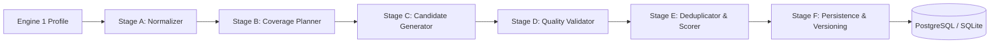

# Auralyt — Engine 2: Prompt Intelligence Specification & Architecture Report

## 1. Executive Summary

**Engine 2 (Prompt Intelligence)** converts an onboarded brand's verified ground-truth profile (produced by Engine 1) into a structured, high-quality matrix of natural-language AI evaluation prompts.

These prompts model how prospective customers, researchers, and enterprise buyers query large language models (such as ChatGPT, Perplexity, Gemini, and Claude) about the brand, its industry, and its competitor alternatives.

### Key Tenets & Boundaries
- **Strict Grounding:** Every generated prompt is rooted in verified brand facts (products, services, features, target audiences, use cases, pricing statements, and differentiators) extracted by Engine 1.
- **Zero Hallucination Policy:** If a brand profile lacks public pricing or specific product dimensions, Engine 2 never invents fictitious numbers or features.
- **No Independent Crawling:** Engine 2 performs zero external HTTP crawling; it consumes Engine 1's frozen profile contract and internal database models.
- **Offline-Safe & Cost-Bounded:** Includes an explainable `DeterministicGenerator` by default that executes instantly without paid LLM API calls, plus an optional `GeminiGenerator` adapter with strict token bounds.
- **Profile Version Pinning:** Generated prompts are explicitly linked to the profile version that produced them. If an administrator refreshes a brand's website crawl in Engine 1, existing user-curated prompts remain intact, and new generation runs target the bumped profile version.

---

## 2. Six-Stage Generation Pipeline

The architecture follows a modular, pipeline-oriented design located in [`app/prompts/`](file:///c:/Users/sahaa/IntelliJ/Projects/Auralyt_MVP/app/prompts/):



### Stage A — Profile Normalization ([`normalizer.py`](file:///c:/Users/sahaa/IntelliJ/Projects/Auralyt_MVP/app/prompts/normalizer.py))
- Ingests raw brand records, verified facts, and profile summary payloads.
- Converts arbitrary dictionaries or SQLAlchemy models into a strongly-typed [`NormalizedBrandProfile`](file:///c:/Users/sahaa/IntelliJ/Projects/Auralyt_MVP/app/prompts/models.py).
- Groups facts into high-confidence categories: `business_overview`, `products_and_services`, `target_audiences`, `use_cases`, `pricing`, `differentiators`, and `faqs`.
- Distinguishes user-confirmed facts from proposed facts. Retains provenance URLs and evidence snippets for downstream citations.

### Stage B — Intent & Coverage Planning ([`planner.py`](file:///c:/Users/sahaa/IntelliJ/Projects/Auralyt_MVP/app/prompts/planner.py))
- Computes an adaptive slot allocation across 8 evaluation categories:
  1. `discovery`: Generic category and problem queries (e.g. *"What are the leading tools for...?"*)
  2. `recommendations`: Solution recommendations for specific workflows.
  3. `comparisons`: Evaluation against market alternatives.
  4. `product_evaluation`: In-depth analysis of specific capabilities and architecture.
  5. `use_cases`: Problem-solution mapping grounded in documented use cases.
  6. `pricing_value`: Cost-effectiveness and licensing inquiries (only if pricing facts exist).
  7. `audience_specific`: Tailored to documented target demographics and user personas.
  8. `brand_research`: Specific inquiries regarding the brand's verified differentiators and track record.
- Maps each slot across buying stages (`awareness`, `consideration`, `decision`) and search intents (`informational`, `commercial`, `transactional`, `comparative`).

### Stage C — Candidate Generation ([`generator.py`](file:///c:/Users/sahaa/IntelliJ/Projects/Auralyt_MVP/app/prompts/generator.py))
- Implements the `BasePromptGenerator` abstract interface.
- **`DeterministicGenerator`:** Generates grammatically varied, grounded questions using parameterized templates dynamically populated with verified facts. Guarantees 0ms latency, zero API costs, and deterministic test reproducibility.
- **`GeminiGenerator`:** Pluggable LLM generator calling Google Gemini with structured JSON output, bounded input context, and exponential backoff retry.
- Resolves generators via factory: switches to `gemini` if `GEMINI_API_KEY` is present and requested, otherwise falls back gracefully to `deterministic`.

### Stage D — Quality Validation ([`validator.py`](file:///c:/Users/sahaa/IntelliJ/Projects/Auralyt_MVP/app/prompts/validator.py))
- Performs multi-layer sanity checks on every generated prompt:
  - **Length & Structure:** Length must be between 15 and 500 characters; must end with a question mark.
  - **Natural Phrasing:** Rejects robotic filler (e.g., *"Prompt: ...*", *"Here is a question..."*).
  - **Hallucination Defense:** If a prompt discusses specific dollar prices or tiers, validates that the profile genuinely contains confirmed pricing facts.
  - **Grounding Verification:** Verifies brand name or relevant entity presence.

### Stage E — Deduplication & Explainable Scoring ([`scorer.py`](file:///c:/Users/sahaa/IntelliJ/Projects/Auralyt_MVP/app/prompts/scorer.py))
- **Deduplication:** Normalizes text (lowercase, punctuation stripping) and computes pairwise Jaccard word-overlap similarity. Candidates with similarity > 0.82 are rejected as near-duplicates.
- **Explainable Scoring:** Produces transparent, bounded sub-scores in `[0.0, 1.0]`:
  - `relevance`: Entity relevance to the brand and category.
  - `grounding`: Proportion of claims linked to verified provenance fact IDs.
  - `intent_clarity`: Strong linguistic intent indicators (*"best"*, *"how"*, *"pricing"*, *"compare"*).
  - `diversity`: Lexical distinctness within the current batch.
  - `overall_quality`: Weighted harmonic combination exposed as `quality_score`.

### Stage F — Persistence & Versioning ([`service.py`](file:///c:/Users/sahaa/IntelliJ/Projects/Auralyt_MVP/app/prompts/service.py))
- Records each generation session in the `prompt_runs` table with provider metadata, duration, token usage, and status.
- Persists individual candidates in `prompt_candidates` linked to `brand_id`, `prompt_run_id`, and `profile_version`.
- Supports idempotency: re-requesting generation for the same brand and profile version returns existing cached results unless `force_regenerate=True`.
- Supports granular human curation: prompts can be approved, rejected, edited, or archived without losing audit provenance.

---

## 3. Database Schema & Migration

Database migration applied in [`alembic/versions/d45231558514_add_prompt_runs_and_candidates.py`](file:///c:/Users/sahaa/IntelliJ/Projects/Auralyt_MVP/alembic/versions/d45231558514_add_prompt_runs_and_candidates.py):

### Table: `prompt_runs`
| Column | Type | Constraints / Description |
|---|---|---|
| `id` | VARCHAR(36) | Primary Key (UUID) |
| `brand_id` | VARCHAR(36) | Foreign Key -> `brands.id` (ON DELETE CASCADE) |
| `profile_version` | INTEGER | Version of the brand profile used for generation |
| `status` | VARCHAR(30) | `pending`, `running`, `completed`, `failed` |
| `prompt_count_requested` | INTEGER | User-specified target count |
| `prompts_generated` | INTEGER | Number of validated prompts produced |
| `provider` | VARCHAR(50) | `deterministic`, `gemini` |
| `model_name` | VARCHAR(100) | Optional model identifier |
| `tokens_used` | INTEGER | Optional token consumption metric |
| `duration_seconds` | FLOAT | Generation latency |
| `error_summary` | TEXT | Sanitized error message if failed |
| `created_at` | TIMESTAMP | ISO UTC timestamp |
| `completed_at` | TIMESTAMP | Completion timestamp |

### Table: `prompt_candidates`
| Column | Type | Constraints / Description |
|---|---|---|
| `id` | VARCHAR(36) | Primary Key (UUID) |
| `brand_id` | VARCHAR(36) | Foreign Key -> `brands.id` (ON DELETE CASCADE) |
| `prompt_run_id` | VARCHAR(36) | Foreign Key -> `prompt_runs.id` (ON DELETE CASCADE) |
| `profile_version` | INTEGER | Pinned profile version |
| `text` | TEXT | Natural language prompt query |
| `category` | VARCHAR(50) | e.g. `discovery`, `comparisons`, `pricing_value` |
| `intent` | VARCHAR(50) | `informational`, `commercial`, `transactional`, `comparative` |
| `buying_stage` | VARCHAR(50) | `awareness`, `consideration`, `decision` |
| `target_audience` | VARCHAR(255) | Specific persona or demographic targeted |
| `target_product_service` | VARCHAR(255) | Product/feature referenced |
| `language` | VARCHAR(10) | Language code (default `en`) |
| `provenance_fact_ids` | JSON | List of Engine 1 `BrandFact.id` UUIDs |
| `grounding_evidence` | JSON | Supporting text excerpts from crawl |
| `scores` | JSON | Detailed sub-score breakdown |
| `quality_score` | FLOAT | Normalized quality score in `[0.0, 1.0]` |
| `is_approved` | BOOLEAN | Human curation approval flag (default `True`) |
| `is_archived` | BOOLEAN | Soft-archive flag (default `False`) |
| `user_edited` | BOOLEAN | Audit flag indicating human modification |
| `original_text` | TEXT | Retained original prompt text before human edits |
| `created_at` | TIMESTAMP | Creation timestamp |
| `updated_at` | TIMESTAMP | Last updated timestamp |

---

## 4. Frozen API Endpoints

All endpoints are registered under `/api/brands/` and `/api/prompts/` in [`app/api/v1/endpoints/prompts.py`](file:///c:/Users/sahaa/IntelliJ/Projects/Auralyt_MVP/app/api/v1/endpoints/prompts.py):

### 1. `POST /api/brands/{brand_id}/prompts/generate`
Initiates prompt generation for the specified brand.
- **Request Body:**
  ```json
  {
    "prompt_count": 20,
    "categories": ["discovery", "comparisons"],
    "language": "en",
    "force_regenerate": false
  }
  ```
- **Response (`200 OK` or `201 Created`):**
  Returns `PromptRunResponse` with run metadata, status, provider, and duration.
- **Error Responses:**
  - `400 Bad Request`: Brand profile has no extracted facts or completed crawl.
  - `404 Not Found`: Brand does not exist.

### 2. `GET /api/brands/{brand_id}/prompts/runs/{run_id}`
Retrieves generation run status and metrics.

### 3. `GET /api/brands/{brand_id}/prompts`
Lists and filters generated prompts for a brand.
- **Query Parameters:**
  - `page`: Page index (default 1)
  - `page_size`: Items per page (default 20, max 100)
  - `category`: Filter by category (e.g. `discovery`, `pricing_value`)
  - `buying_stage`: Filter by buying stage (`awareness`, `consideration`, `decision`)
  - `is_approved`: Filter by boolean approval status
  - `search`: Case-insensitive substring search on prompt text
- **Response:**
  ```json
  {
    "items": [...],
    "total": 20,
    "page": 1,
    "page_size": 20,
    "total_pages": 1
  }
  ```

### 4. `GET /api/brands/{brand_id}/prompts/coverage`
Retrieves coverage statistics across categories and buying stages:
- **Response:**
  ```json
  {
    "total_prompts": 20,
    "approved_prompts": 20,
    "by_category": { "discovery": 4, "comparisons": 3, "use_cases": 5 },
    "by_buying_stage": { "awareness": 8, "consideration": 7, "decision": 5 },
    "average_quality_score": 0.88
  }
  ```

### 5. `GET /api/prompts/{prompt_id}`
Returns details for a single prompt, including its scores and grounding evidence.

### 6. `PATCH /api/prompts/{prompt_id}`
Updates human curation state or edits the prompt text.
- **Request Body:**
  ```json
  {
    "text": "How does Acme compare with Competitor X for enterprise workflows?",
    "is_approved": true,
    "is_archived": false
  }
  ```
- **Audit Behavior:** Modifying `text` sets `user_edited = True` and archives the prior text into `original_text`.

---

## 5. UI Integration

Integrated seamlessly into the single-page dashboard at `app/static/`:
- **Header:** Updated to **Auralyt Intelligence (Engine 1 & 2)** with direct navigation.
- **Prompt Intelligence Tab (`#tab-prompts`):**
  - **Generator Bar:** Select target prompt count (10, 20, 30, 50), language override, and cache bypass.
  - **Coverage Matrix:** Live summary cards displaying total prompts, approved count, category coverage chips, and average quality score.
  - **Filter & Search Bar:** Multi-dimension filtering by category, buying stage, approval status, and text search.
  - **Prompts Table:** Rich table displaying prompt text, category badge, intent and buying stage chips, quality score badge, grounding inspector, approval toggle, inline edit, and archive action.
  - **Modals:**
    - `edit-prompt-modal`: For reviewing and editing prompt wording.
    - `prompt-evidence-modal`: For inspecting underlying provenance citations and score breakdowns.

---

## 6. Test Suite & Verification Results

The test suite contains **72 automated tests** across both engines:
- **54 Engine 1 Regression Tests:** All SSRF, DNS-pinning, SafeEgressProxy, redirect loops, crawler limits, robots.txt, sitemap parsing, and fact synthesis tests pass untouched.
- **18 Engine 2 Tests:**
  - `test_profile_normalizer_complete`: Validates normalization of all fact categories and provenance references.
  - `test_profile_normalizer_empty`: Handles empty brand profiles cleanly without exceptions.
  - `test_coverage_planner_allocates_slots_proportional`: Validates balanced intent and stage slot planning.
  - `test_coverage_planner_skips_missing_dimensions`: Excludes pricing category when profile lacks pricing data.
  - `test_deterministic_generator_grounding`: Confirms candidate generation referencing real brand facts.
  - `test_prompt_validator_accepts_valid_prompt`: Validates acceptance of clean, well-formed prompts.
  - `test_prompt_validator_rejects_too_short`: Validates rejection of truncated or non-question inputs.
  - `test_prompt_validator_rejects_hallucinated_pricing`: Prevents phantom pricing mentions without profile grounding.
  - `test_deduplication_exact_and_near_duplicate`: Validates lexical deduplication and Jaccard distance threshold.
  - `test_scorer_computes_explainable_scores`: Verifies explainable sub-score calculation and bounded outputs.
  - `test_generate_prompts_success`: End-to-end API test verifying prompt generation from verified facts.
  - `test_list_and_filter_prompts`: Validates query filtering across categories and stages.
  - `test_prompt_update_edit_approve_archive`: Verifies editing, audit flag setting, and archiving.
  - `test_coverage_summary_endpoint`: Validates coverage matrix calculation endpoint.
  - `test_caching_and_idempotency`: Verifies that identical requests reuse generation runs unless forced.
  - `test_profile_version_bump_isolates_prompts`: Validates that refreshing a crawl bumps the version and isolates prompt batches.
  - `test_generate_fails_on_empty_profile`: Verifies proper 400 Bad Request when profiling is incomplete.
  - `test_generate_fails_on_nonexistent_brand`: Verifies proper 404 Not Found error handling.

**Execution Result:**
```
============================= 72 passed in 2.97s ==============================
```
